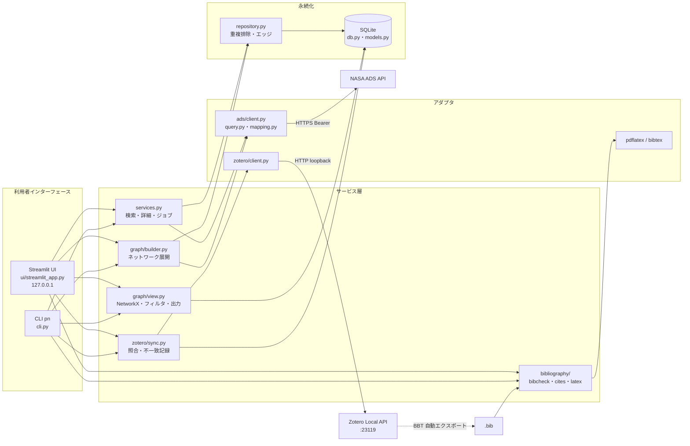
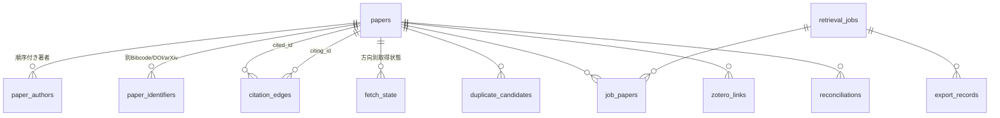

# アーキテクチャ

## 1. 構成図

## 2. モジュール責務

| モジュール | 責務 | 依存してよいもの |
|---|---|---|
| `errors.py` | エラー分類・利用者向け文言 | なし |
| `config.py` | 設定読込、秘密値のマスク、ループバック検証 | errors |
| `logging_utils.py` | UTC ログ、秘密情報の伏字化 | なし |
| `normalize.py` | DOI/Bibcode/arXiv/タイトル正規化 | なし |
| `records.py` | ソース非依存の論文レコード | なし |
| `models.py` / `db.py` | ORM、追記型マイグレーション、トランザクション | errors |
| `repository.py` | 重複排除付き upsert、エッジ、取得状態、ジョブ | models, normalize |
| `ads/*` | ADS クエリ生成、HTTP、ページング、再試行、レスポンス変換 | errors, records, normalize |
| `services.py` | UC-01/03 | ads, repository, db |
| `graph/builder.py` | UC-02（BFS、上限、キャッシュ） | ads, repository, services |
| `graph/view.py` | グラフ読込・フィルタ・HTML/JSON/GraphML/CSV | db, models |
| `zotero/*` | Local API、照合 | db, models, normalize |
| `bibliography/*` | `.bib` 検証、`\cite` 整合、コンパイル | normalize |
| `app.py` | 設定・DB・クライアントの組立て | 全体 |
| `cli.py`, `ui/streamlit_app.py` | 表示と入力のみ（業務ロジックを持たない） | services 他 |

## 3. データフロー

1. **検索**: 入力 → `detect_input` → `build_search_query` → `ADSClient.search`（ページング・再試行）→ `ads_doc_to_record` → `upsert_paper`（重複排除）→ `retrieval_jobs` 更新。
2. **ネットワーク**: 起点解決 → BFS。各（論文, 方向）について `fetch_state` を確認しキャッシュ利用、なければ `references(bibcode:X)` / `citations(bibcode:X)` を取得 → 1 リスト 1 トランザクションで論文・エッジ・`fetch_state` を保存 → 最後に `job_papers` とジョブ結果を保存。
3. **表示**: `load_job_graph(job_id)`（`job_papers` のノード＋その間のエッジ）→ `filter_graph` → `render_html` / `export_all`。
4. **Zotero**: `status()` → `collection_items()` → `sync_collection()`（リンク・不一致を DB に保存、Zotero は不変）。追加は `create_item()`（10+、認可、DOI 重複確認）。
5. **Reference**: BBT が `.bib` を自動出力 → `check_bib` → `check_citations` → `build`（一時ディレクトリでコンパイル、公式スタイルを無改変コピー）。

## 4. DB 設計（スキーマ v2）

| テーブル | 主な列 | 制約 |
|---|---|---|
| `papers` | title, year, pub, bibstem, volume, issue, page, doctype, doi, bibcode, arxiv_id, abstract, source, source_ids(JSON), retrieved_at, missing_fields(JSON), validation_status | doi/bibcode/arxiv_id UNIQUE、validation_status CHECK、year 1000–3000 |
| `paper_authors` | paper_id, position, name, family, given | PK(paper_id, position) |
| `paper_identifiers` | scheme, value | UNIQUE(scheme, value) |
| `citation_edges` | citing_id, cited_id, source, source_query, job_id, retrieved_at, verification_status | UNIQUE(citing_id, cited_id)、FK |
| `fetch_state` | paper_id, direction, fetched_at, num_found, num_fetched, complete, job_id | direction CHECK |
| `retrieval_jobs` | kind, query, params(JSON), seed_paper_id, started/finished_at, status, error_code/detail, requests_made, pages_fetched, cache_hits, papers_found, edges_found, skipped, truncated, truncation_reason, paging_state, software_version | status CHECK |
| `job_papers` | job_id, paper_id, depth, role | role CHECK |
| `duplicate_candidates` | paper_a, paper_b, score, reason, status | paper_a < paper_b、UNIQUE |
| `zotero_links` | paper_id, zotero_key, library, citation_key, matched_by, last_checked_at | PK |
| `reconciliations` | paper_id, zotero_key, field, ads_value, zotero_value, decision | decision CHECK |
| `export_records` | kind, path, job_id, details | — |
| `schema_migrations` | version, description, applied_at | — |

SQLite は `PRAGMA foreign_keys=ON`、WAL モード。
マイグレーション: v1 = 上記テーブル群（0.1.0）、v2 = 索引 `ix_papers_year`、`ix_authors_family(lower(family), position)`（0.1.1、ADR-012）。
バックアップは `Database.backup`（SQLite バックアップ API）、中断ジョブの検出は起動時の `repository.mark_stale_jobs`。

## 5. 外部サービス

| サービス | 方式 | 失敗時 |
|---|---|---|
| NASA ADS | HTTPS + Bearer、`/search/query` | 429/5xx/タイムアウトは指数バックオフ（`Retry-After` 優先、最大60秒）で再試行、日次上限枯渇時は即停止。401/403/400 は再試行しない |
| Zotero Local API | HTTP loopback :23119 | 接続不可は ZOTERO_UNAVAILABLE、403 は Local API 無効 |
| TeX | サブプロセス、タイムアウト 180 秒 | LATEX_BUILD_ERROR / ログ解析結果 |

## 6. P1 拡張ポイント
新規テーブル（例 `paper_files`, `translations`, `models`）を `papers.id` 参照で追加し、新マイグレーション v2 以降として追記する。
サービスは新モジュール（例 `fulltext/`, `translation/`）として追加し、既存アダプタを変更しない。P1 用のスタブは作成していない。
