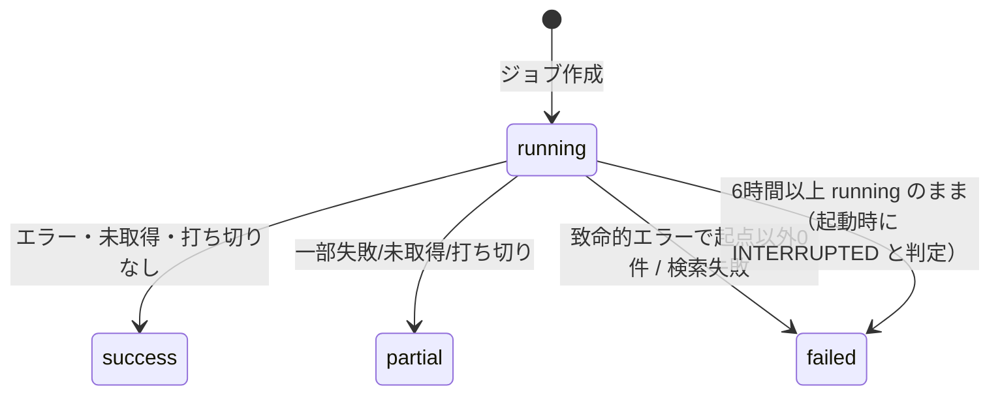

# Paper Navigator システム仕様書（P0）

## 0. 文書管理

| 項目 | 内容 |
|---|---|
| 文書名 | Paper Navigator システム仕様書 |
| 対象ソフトウェア | Paper Navigator（Python パッケージ `paper-navigator`） |
| 文書識別子 | PN-SPEC-001 |
| 版 | 0.2（対象ソフトウェア版 0.1.1） |
| 作成日 | 2026-11-12 |
| 最終更新日 | 2026-11-12 |
| 作成者 | Claude Opus 5.5（実装担当） |
| レビュー担当者 | 第三者レビュー未実施。作成者による自己レビューとチェックリスト監査のみ（§15、[監査](SOFTWARE_SPECIFICATION_CHECKLIST_AUDIT.md)） |
| 承認者 | 利用者（**未承認**。Claude は承認済みとしない） |
| 文書の状態 | 草案（利用者レビュー待ち） |

### 0.1 変更履歴

| 版 | 日付 | 変更内容 | 理由 |
|---|---|---|---|
| 0.1 | 2026-11-12 | 初版（P0 実装と同時に作成） | 実装指示書に基づく |
| 0.2 | 2026-11-12 | 文書識別子・レビュー欄・命名規則・利用者権限・操作/自動処理の区別・入出力表・容量・CRUD・バックアップ・状態遷移・並行処理・測定可能な非機能要件・脅威整理・エラー重大度・自己レビューを追加。要件を細分化 | 仕様書チェックリスト監査の指摘（`[ ]` 項目）への是正 |

ソフトウェアの変更履歴は [CHANGELOG.md](../CHANGELOG.md)。

### 0.2 関連文書・参考資料・外部規格

| 種別 | 文書 |
|---|---|
| 本プロジェクト | [README](../README.md)、[ARCHITECTURE](ARCHITECTURE.md)、[DECISIONS](DECISIONS.md)、[EXTERNAL_SPECS](EXTERNAL_SPECS.md)、[TRACEABILITY_MATRIX](TRACEABILITY_MATRIX.md)、[TEST_PLAN](TEST_PLAN.md)、[OPERATIONS](OPERATIONS.md)、[DEVELOPMENT](DEVELOPMENT.md)、[ZOTERO_BBT_SETUP](ZOTERO_BBT_SETUP.md)、[APJ_REFERENCES](APJ_REFERENCES.md)、[SURVEY](SURVEY.md) |
| 入力資料 | 実装指示書（利用者提供）、[ソフトウェア仕様書チェックリスト](reference/software_specification_checklist.md)（利用者提供、SHA-256 `b324712f…a6ea67`） |
| 外部仕様 | NASA ADS Search API、Zotero Local API、Better BibTeX、AASTeX v7 / AAS BibTeX スタイル（URL と確認日は EXTERNAL_SPECS） |
| 規格・慣行 | ISO 8601（日時）、Semantic Versioning 2.0.0（版番号）、BibTeX、GraphML、NetworkX node-link JSON |

### 0.3 記述区分

**確定**＝実装しテストで確認済み、**仮定**＝合理的に置いた前提、**提案**＝将来案、**未決**＝利用者の判断待ち、**要確認**＝外部環境での確認待ち（ライブ API・実機）。
未決・仮定・要確認は §16 に集約する。

### 0.4 用語・略語・記号

| 用語 | 定義 |
|---|---|
| ADS | NASA Astrophysics Data System |
| Bibcode | ADS の 19 文字の論文識別子（例 `1998ApJ...509..678G`）。大文字小文字を区別 |
| References（先行研究） | ある論文が引用している文献 |
| Citations（後続研究） | ある論文を引用している文献 |
| 起点論文（seed） | ネットワーク構築の出発点 |
| BBT | Better BibTeX for Zotero |
| ジョブ | 1 回の検索またはネットワーク構築の記録（`retrieval_jobs`） |
| リスト | ある論文の References または Citations の一覧（ADS の 1 クエリ結果） |
| 完全（complete） | リストの取得件数＋スキップ件数が ADS の `numFound` 以上で、エラーなし |
| 打ち切り（truncated） | 上限またはエラーで取得を途中終了したこと |
| 重複候補 | 自動統合しない、人手確認用の類似論文ペア |
| **記号 `A → B`** | 論文 A が論文 B を引用している（DB・UI・全エクスポートで共通） |
| UTC | 協定世界時。内部の日時はすべて UTC の ISO 8601（`+00:00` 付き） |

### 0.5 命名規則

| 対象 | 規則 | 例 |
|---|---|---|
| 要件 ID | `PN-<領域>-<3桁>`（領域: ADS, GRAPH, DB, ZOT, BBT, APJ, UI, SEC, OPS, NFR, P1）。廃止しても再利用しない | PN-ADS-004 |
| ユースケース ID | `UC-<2桁>` | UC-02 |
| 設計判断 | `ADR-<3桁>` | ADR-005 |
| チェックリスト監査 | `CHK-<章2桁>-<連番2桁>` | CHK-04-03 |
| Python | モジュール・関数・変数は snake_case、クラスは PascalCase、定数は UPPER_CASE（ruff で検査） | `build_network`, `NetworkParams` |
| DB | テーブルは snake_case 複数形、列は snake_case、日時列は `*_at` | `citation_edges.retrieved_at` |
| エクスポート | `network_job<ジョブID>.<拡張子>`、エッジ CSV は `network_job<ID>_edges.csv` | `network_job3.html` |
| バックアップ | `<DB名>-<UTC YYYYMMDDTHHMMSSZ>.sqlite3` | `paper_navigator-20261112T060000Z.sqlite3` |

## 1. 背景・目的・スコープ

### 1.1 背景と課題
研究者は起点論文から先行研究と後続研究をたどり、執筆時には書誌情報を正確に管理し、投稿先の書式で Reference を出力する必要がある。
これらは別々のツールで手作業になりがちで、出典・取得状態の追跡や引用キーの整合性確認が難しい。

### 1.2 目的と期待する成果
1. 論文検索と引用関係の取得・保存を自動化し、出典・取得日時・欠落・取得状態を追跡可能にする。
2. 引用関係を有向グラフとして可視化し、先行・後続研究を体系的に探索できるようにする。
3. Zotero + Better BibTeX を書誌の正本とし、ApJ 用 Reference を AAS 公式スタイルで出力・検証できるようにする。

### 1.3 対象利用者・利用場面
天文学・天体物理学（特に太陽物理学）の個人研究者 1 名が、自分の PC で、文献調査時と論文執筆・投稿準備時に使う。データモデルは他分野にも適用可能（仮定）。

### 1.4 対象範囲（P0）
P0-A 論文検索・メタデータ取得、P0-B 引用ネットワーク構築・可視化、P0-C 論文 DB、P0-D Zotero/BBT 連携、P0-E ApJ/AAS Reference 出力、P0-F ローカル Web UI。要件一覧は [TRACEABILITY_MATRIX](TRACEABILITY_MATRIX.md)。

### 1.5 対象外の機能・責任範囲
- 機能（P1 以降）: PDF 取得・本文抽出、Docling/GROBID、LLM 翻訳・要約、段落対応・数式保護、共引用・書誌結合分析。UI サイドバーに「未実装」と表示する。
- 責任範囲外: ADS の引用データ自体の正確性・網羅性、Zotero/BBT/AASTeX の不具合、原稿全体の投稿規定適合（`.bst` 使用は規定適合を保証しない）、引用数による研究の質・重要度の評価（行わない）。

### 1.6 利用者の前提知識と権限
- 前提知識: ADS で論文を検索した経験、Zotero の基本操作、LaTeX/BibTeX による論文執筆、ターミナルでのコマンド実行（`uv` の導入を含む）。
- 必要な権限: OS の一般ユーザー権限（管理者権限は不要）、ADS アカウントと API トークン、Zotero の設定変更（Local API の有効化）。Zotero 10+ で書き込む場合は Zotero 上での許可操作。
- アプリ内の権限区分はない（単一利用者、§2.1）。

### 1.7 成功条件・受入れの考え方
実装指示書 §9.2 の合格基準 1〜10 を受入れ基準とする。判定結果は [TEST_PLAN](TEST_PLAN.md) §6。
モックでのみ検証された要件は「検証済み（モック）」として区別し、ライブ接続での確認を利用者の受入れ作業とする（§16）。

### 1.8 前提条件・依存条件・既知の制約
- 依存: NASA ADS API（トークン、5000 リクエスト/日）、Zotero 7+（書き込みは 10+）、BBT（自動エクスポートは Zotero 起動中のみ）、TeX Live + AASTeX。
- 制約: Python ≥3.12（NetworkX 3.7 の要件）。開発環境から ADS・AAS サイトに接続できず、Zotero 実機もないため、これらはモック検証のみ。
- 既知の制約の一覧は [OPERATIONS](OPERATIONS.md) §6。

### 1.9 関連する研究プロセスとの関係
文献調査（ADS 検索 → 引用ネットワーク探索）→ 文献管理（Zotero へ登録、BBT で引用キー付与）→ 執筆（`\citep`/`\citet`）→ 投稿準備（`.bib` 検証、AASTeX でコンパイル、AAS 投稿前チェックリスト）。
本システムは前半 2 段の自動化と後半の検証を担い、執筆・投稿そのものは利用者が行う。

## 2. 利用者・ユースケース・業務フロー

### 2.1 利用者の種類・役割
利用者は「研究者（所有者）」の 1 種類のみ。運用者・管理者を兼ねる。機能差・権限差はない（複数利用者・ロールは想定しない。必要になった場合は §17 の提案を参照）。

### 2.2 ユースケース

| ID | 名称 | 開始条件 | 入力 | 処理 | 結果 | 異常系・境界条件 |
|---|---|---|---|---|---|---|
| UC-01 | 論文を検索する | 利用者が検索文字列を入力し実行 | 文字列（1〜500 文字）、種別（自動判定可）、年範囲、最大件数（1〜200） | 入力検証 → クエリ生成 → （識別子かつキャッシュ有効なら DB）→ ADS 取得 → 検証 → DB 保存 → ジョブ記録 | 候補一覧とメタデータ、取得元、状態（成功／部分成功／0件／失敗／キャッシュ） | 空・501 文字以上・制御文字、0件、トークン無し、401/403、タイムアウト、429、応答形式不正、numFound が表示件数より多い |
| UC-02 | 引用ネットワークを作成する | 利用者が起点を指定し実行 | 起点（Bibcode/DOI/arXiv/#ID）、方向、階層数 1〜5、最大論文数 1〜20000、最大リクエスト数 1〜5000、期間 | 起点解決 → BFS（§3.2 の手順）→ ジョブ記録 | グラフ（ノード・エッジ・役割・階層・取得状況）、打ち切り理由、未取得リスト | 一部失敗、重複、循環、上限到達、0件、認証失敗・レート制限による中断、起点が 0 件／複数件、Bibcode 無し |
| UC-03 | 論文詳細を開く | 利用者がノードをクリック、または UI で選択・入力 | ノード／識別子 | DB からメタデータ取得 | 書誌、Abstract、DOI/Bibcode/arXiv リンク、取得元・日時、欠落項目、Zotero 登録状態 | 欠落は「未取得」、リンク無し、DB に該当なし |
| UC-04 | Zotero と同期する | 利用者が状態確認・照合・追加を実行 | コレクションキー（8 文字英大文字数字）、論文 | 版・API 有効性・認可状態の確認 → 照合・不一致記録（Zotero 不変）／DOI 重複確認後に追加 | 接続状態 5 種、照合結果、追加結果（created/exists/unsupported/needs_authorization/failed） | Zotero 停止、ポート不通、API 無効、Zotero <10、認可不足・キー消費、既存文献、412/428/5xx |
| UC-05 | ApJ Reference を出力する | 利用者が `.bib` と `.tex` を指定し実行 | BBT の `.bib`、原稿 `.tex`、スタイルディレクトリ | `.bib` 検証 → 引用キー整合 → pdflatex→bibtex→pdflatex×2 → ログ解析 | 検証結果、PDF、`.bbl`、未解決引用、BibTeX 警告・エラー | キー重複、必須欠落、構文不正、スタイル不在、未解決引用、LaTeX エラー、非 UTF-8 |

### 2.3 利用者による操作とシステムの自動処理

| UC | 利用者が行う操作 | システムが自動で行う処理 |
|---|---|---|
| UC-01 | 文字列・条件の入力、実行、起点の選択 | 種別判定、クエリ生成・エスケープ、キャッシュ判定、ページング、再試行、正規化、重複排除、保存、ジョブ記録 |
| UC-02 | 起点・方向・上限の指定、実行、フィルタ操作、エクスポート操作 | BFS 展開、キャッシュ再利用、上限管理、エッジ方向の付与、役割判定、トランザクション、打ち切り記録 |
| UC-03 | ノードのクリック／選択 | 詳細の取得と表示、リンクの検証（ADS・doi.org・arXiv の https のみ） |
| UC-04 | Zotero の Local API 有効化、許可ダイアログでの承認、照合・追加の実行 | 版・状態判定、DOI 重複確認、照合、不一致の判定と記録、キーの安全な保存 |
| UC-05 | BBT 自動エクスポートの設定、ファイル指定、実行、警告への対応 | `.bib` 検証、キー整合、公式スタイルの無改変コピー、コンパイル、ログ解析 |
| 共通 | — | 起動時のマイグレーション、中断ジョブの検出（6 時間以上 running → failed/INTERRUPTED） |

### 2.4 ユースケース間の前後関係・依存関係
- UC-02 は起点が DB にあるか、UC-01 と同じ検索で 1 件に解決できることが前提。
- UC-03 は UC-01 または UC-02 で論文が保存済みであることが前提。
- UC-04 の照合は、照合対象の論文が DB にあることが前提（無い場合は「DB 未登録」と報告）。
- UC-05 は BBT 自動エクスポートで `.bib` が作られていることが前提（Zotero 側の運用、[ZOTERO_BBT_SETUP](ZOTERO_BBT_SETUP.md)）。
- 業務フロー: UC-01 → UC-02 → UC-03 → UC-04 →（BBT 自動エクスポート）→ UC-05。

## 3. 機能要件

### 3.0 優先度・状態の区分
優先度: **MUST**（P0 で必須）、**SHOULD**（P0 で実装するが、環境により代替手段を許容）、**WON'T(P0)**（P1 以降）。
状態: 未着手／検討中／確定／実装済み／検証済み／対象外（「検証済み（モック）」はライブ未検証）。
要件ごとの ID・期待動作・優先度・根拠・検証方法・状態は [TRACEABILITY_MATRIX](TRACEABILITY_MATRIX.md)。

#### 機能一覧（目的・責務・起動条件・前提条件）

| 機能 | 目的・責務 | 起動条件 | 前提条件 | 主な要件 |
|---|---|---|---|---|
| F-SEARCH | ADS で論文を特定し、メタデータを出典付きで保存する | UC-01 の実行 | ADS トークン（識別子のキャッシュ応答は不要） | PN-ADS-001〜009 |
| F-NETWORK | 起点から References/Citations を取得し引用関係を保存する | UC-02 の実行 | 起点が 1 件に解決できる、起点に Bibcode がある | PN-GRAPH-001〜004, 008 |
| F-VIEW | ジョブのグラフを読み込み、フィルタ・表示・出力する | グラフタブ表示、`pn export-graph` | ネットワークジョブが存在する | PN-GRAPH-005〜007 |
| F-DB | 重複排除・制約・トランザクション・キャッシュ・移行・バックアップ | 他機能から呼出し、起動時、`pn backup` | 書き込み可能な `data/` | PN-DB-001〜008 |
| F-ZOTERO | Zotero の状態判定・読取・照合・追加 | UC-04 の実行 | Zotero 起動・Local API 有効（追加は 10+ と許可） | PN-ZOT-001〜004 |
| F-BIB | `.bib` の検証とキー変更検出 | `pn bib-check`、UI | BBT が出力した UTF-8 の `.bib` | PN-BBT-001〜003 |
| F-APJ | 引用キー整合と公式スタイルでのコンパイル検証 | `pn cite-check`/`apj-build`、UI | pdflatex/bibtex、AASTeX ファイル | PN-APJ-001〜003 |
| F-UI | 上記の操作と状態表示を 1 画面に統合 | `pn ui` | Streamlit、ループバック | PN-UI-001〜003 |
| F-OPS | 設定・ログ・ジョブ記録・中断検出 | 起動時・各処理 | — | PN-OPS-001〜003, PN-SEC-001〜003 |

### 3.1 F-SEARCH 論文検索（PN-ADS-001〜009）
- 目的・責務: ADS で論文を特定し、メタデータを出典付きで保存する。
- 起動条件: UC-01 の実行。トークン無しでも識別子検索はキャッシュから応答可。
- 入力: §4.1。処理: 種別判定（DOI → Bibcode → arXiv → タイトルの順に最初に形式が合うもの）→ クエリ生成（DOI `doi:"…"`、Bibcode `identifier:"…"`、arXiv `identifier:"arXiv:…"`、タイトル `title:"…"`、年 ` year:[a TO b]`、引用符・`\` はエスケープ）→ `start` を `rows` ずつ増やして取得 → 変換 → 保存。
- 終了条件: 取得件数が最大件数に達した、`start ≥ numFound`、空ページ、またはエラー。
- 成功条件: エラーなしで終了。`numFound = 0` かつエラーなしは「0件」（失敗ではない）。
- 失敗時: 1 ページ目のエラーは失敗としてジョブに分類コードを記録。2 ページ目以降のエラーは取得済みを保持して部分成功。
- 保存項目: §5.1。値が無い項目は NULL、推測値を格納しない。不正形式（DOI 等）は破棄し警告を返す。Bibcode の無い文書はスキップ件数に計上（作り出さない）。

### 3.2 F-NETWORK 引用ネットワーク構築（PN-GRAPH-001〜004, 008, PN-ADS-002）
- 目的: 起点から References/Citations をたどり、引用関係を有向グラフとして保存する。
- 起動条件: UC-02 の実行。パラメータ検証（§4.1）に失敗した場合は処理を開始せず INPUT_ERROR。
- 処理手順:
  1. 起点を DB から解決。無ければ UC-01 と同じ検索（最大 2 件）を行い、ちょうど 1 件でなければ失敗（0 件: NOT_FOUND、2 件以上: INPUT_ERROR）。起点に Bibcode が無ければ失敗。
  2. ジョブを `running` で作成し、起点を深さ 0・役割 `seed` で登録。
  3. キュー（BFS）から論文 P（深さ d）を取り出す。d が階層数以上なら展開しない。
  4. 方向ごとに: (a) `fetch_state` が完全かつ TTL 内なら DB のエッジから隣接論文を得る（キャッシュ）。(b) そうでなければ、リクエスト数が上限なら打ち切り（理由 `max_requests`）、論文数が上限なら打ち切り（`max_papers`）。(c) ADS に `references(bibcode:"P")` または `citations(bibcode:"P")` を問い合わせ、残り容量件数まで取得。(d) 1 リスト 1 トランザクションで論文 upsert・エッジ（References: `P → 参照先`、Citations: `引用元 → P`）・`fetch_state` を保存。(e) 新規論文を深さ d+1 でキューへ（論文数上限を超える分は登録しない）。
  5. 認証失敗・レート制限・設定エラーは致命的として残りを中断（理由 `aborted_on_error`）。その他のエラーは当該リストを未取得として記録し継続。
  6. キューが空になるか中断したら、`job_papers` と結果（状態・件数・リクエスト数・キャッシュ利用・打ち切り理由・未取得リスト）を保存。
- 終了条件: キューが空、または致命的エラー。
- 成功条件: エラー・未取得リスト・打ち切りがすべて無い場合のみ `success`。いずれかがあれば `partial`。致命的エラーで起点以外が 0 件なら `failed`。
- 役割: Reference リスト経由で到達＝`reference`、Citation リスト経由＝`citation`、両方＝`both`（ADR-011）。
- 同一論文は 1 ノード（§6.2）。循環・共有参照はそのまま保持（DAG を仮定しない）。自分自身へのエッジは作らない。
- 期間指定時の取得結果はキャッシュ上「完全」としない。

### 3.3 F-VIEW グラフ表示・フィルタ・出力（PN-GRAPH-005〜007, PN-SEC-002）
- 入力: ジョブ ID、フィルタ（年範囲、役割、最大階層、年不明を含めるか）。起点は常に表示。
- 出力: HTML（オフライン動作、§4.2）、JSON、GraphML、エッジ CSV。
- 表示: ノードは役割ごとに形・記号・色が異なる（★●▲◆）。クリックで詳細パネル（§2.2 UC-03 の項目）。凡例と「A → B」の意味、引用数が質を示さない旨を常時表示。
- 失敗時: ジョブが無い・ネットワークジョブでない場合は NOT_FOUND。

### 3.4 F-DB 永続化（PN-DB-001〜008）
- 重複排除の優先順位: ①正規化 DOI ②ADS Bibcode（別 Bibcode を含む）③arXiv ID。一致した場合のみ統合。
- 類似タイトル（§6.2 の基準）は重複候補として記録するのみ。1 レコードの識別子が別々の既存論文を指す場合は統合せず `identifier_conflict` 候補を記録。
- 既知の値を NULL で上書きしない。トランザクション単位でコミット／ロールバック（§7.3）。
- キャッシュ: 完全取得済みかつ TTL（既定 30 日、0 以上の整数日）内のリスト、および TTL 内の識別子検索は API を呼ばない。`--refresh` で無効化。

### 3.5 F-ZOTERO（PN-ZOT-001〜004）
- 状態判定: 接続不可 → `unavailable`、HTTP 403 → `local_api_disabled`、版 <10 またはサーバー ID 無し → `read_only`、10+ でキー無し → `write_needs_authorization`、10+ でキー有り → `read_write`。
- 書き込み: Zotero 10+ かつキーがある場合のみ。同 DOI のアイテムがあれば追加しない。Zotero が作成キーを返した場合のみ `created`。
- 照合: DOI 一致、または Zotero の Extra/URL 中の ADS Bibcode 一致でリンク。タイトル類似のみではリンクせず `possible_match` と報告。
- 不一致判定: §6.4。

### 3.6 F-BIB / F-APJ（PN-BBT-001〜003, PN-APJ-001〜003）
- `.bib` は読み取りのみ。検証規則は §6.5。キー変更は承認スナップショットとの比較で検出。
- コンパイルは一時ディレクトリで実行し、公式 `.cls`/`.bst` をバイト単位でそのままコピー。PDF 生成（success）と警告なし（clean）を区別して報告。

### 3.7 F-UI（PN-UI-001〜003）
5 タブ（検索／引用グラフ／論文詳細／Zotero・BibTeX／ApJ Reference）。画面・状態・入力制約は §4.3.2。

### 3.8 要件の重複・矛盾の確認結果
2026-11-12 に要件一覧（58 件）を相互に照合した。主な確認と結論:
- 「キャッシュ利用（PN-DB-005）」と「最新データの取得」: TTL と `--refresh` で両立。
- 「Zotero への追加（PN-ZOT-003）」と「`.bib` をシステムで生成しない（ADR-008）」: 追加は Zotero に対して行い、`.bib` は BBT が生成するため矛盾しない。
- 「期間指定（PN-GRAPH-004）」と「完全性の表示（PN-ADS-004）」: 期間指定の取得は完全としないことで矛盾を回避。
- 指示書の `aasjournal.bst` と AAS 一次資料（v7 は `aasjournalv7*.bst`）の相違: 一次資料を優先（ADR-007、要件側に明記）。
- 未解消の矛盾: なし。

## 4. 入力・出力・インターフェース

### 4.1 入力

| 項目 | 型・形式 | 単位 | 必須 | 既定値 | 許容範囲・制限 | 入力元 | 不正時の扱い |
|---|---|---|---|---|---|---|---|
| 検索文字列 | UTF-8 文字列 | 文字 | 必須 | — | 1〜500 文字、制御文字不可、ADS クエリ全体 ≤1000 文字 | UI/CLI | INPUT_ERROR（処理開始前） |
| 種別 | `doi`/`bibcode`/`arxiv`/`title` | — | 任意 | 自動判定 | 指定時は形式検証 | UI/CLI | INPUT_ERROR |
| 年（から・まで） | 整数 | 西暦年 | 任意 | 指定なし（UI では 0） | 0〜3000、から ≤ まで | UI/CLI | INPUT_ERROR |
| 最大件数（検索） | 整数 | 件 | 任意 | 25 | UI 1〜200 | UI/CLI | UI が範囲外入力を拒否 |
| 起点 | Bibcode/DOI/arXiv/`#ID` | — | 必須 | UI は検索で選択した値 | §3.2 手順 1 | UI/CLI | NOT_FOUND / INPUT_ERROR |
| 方向 | `references`/`citations`/`both` | — | 任意 | `both` | 3 値 | UI/CLI | INPUT_ERROR |
| 階層数 | 整数 | 階層 | 任意 | 1（`PN_NETWORK_DEPTH`） | 1〜5 | UI/CLI/環境変数 | INPUT_ERROR / CONFIG_ERROR |
| 最大論文数 | 整数 | 件 | 任意 | 300（`PN_NETWORK_MAX_PAPERS`） | 1〜20000 | 同上 | 同上 |
| 最大リクエスト数 | 整数 | 回 | 任意 | 50（`PN_NETWORK_MAX_REQUESTS`） | 1〜5000 | 同上 | 同上 |
| キャッシュ TTL | 整数 | 日 | 任意 | 30 | ≥0 | 環境変数 | CONFIG_ERROR |
| ADS トークン | 文字列（秘密） | — | 検索時必須 | — | 前後空白除去 | `.env`/環境変数 | CONFIG_ERROR |
| ADS タイムアウト | 実数 | 秒 | 任意 | 30 | — | 環境変数 | CONFIG_ERROR |
| ADS 再試行回数 | 整数 | 回 | 任意 | 3 | ≥0 | 環境変数 | CONFIG_ERROR |
| ADS ページサイズ | 整数 | 件 | 任意 | 200 | 1〜2000（超過は 2000 に丸め） | 環境変数 | CONFIG_ERROR |
| Zotero URL | http URL | — | 任意 | `http://127.0.0.1:23119` | ホストは 127.0.0.1/localhost/::1 のみ（`ZOTERO_ALLOW_REMOTE=1` で解除） | 環境変数 | CONFIG_ERROR |
| コレクションキー | 英大文字・数字 8 文字 | — | 照合時必須 | — | `[A-Z0-9]{8}` | UI/CLI | INPUT_ERROR |
| `.bib` | UTF-8 テキスト | — | UC-05 必須 | — | 拡張子 `.bib`、存在すること | ファイル（BBT） | ENCODING / IO_ERROR / UI は INPUT_ERROR |
| `.tex` | UTF-8 テキスト | — | UC-05 必須 | — | 拡張子 `.tex` | ファイル | 同上 |
| ADS 応答 | JSON（`response.numFound`/`docs`） | — | — | — | オブジェクトであること | ADS API | INVALID_RESPONSE |
| Zotero 応答 | JSON（Web API v3 形式） | — | — | — | — | Zotero | INVALID_RESPONSE |

欠損値は NULL として保持、空文字列は欠損と同じに扱う。重複値（同一識別子）は §3.4 で統合。正規化方法は §6.1。

### 4.2 出力

| 出力 | 形式 | 出力先 | 命名・場所 | 内容・精度 |
|---|---|---|---|---|
| DB | SQLite 3（WAL） | ファイル | `PN_DB_PATH`（既定 `data/paper_navigator.sqlite3`） | §5 |
| グラフ HTML | HTML5 単一ファイル（vis-network 9.1.2 同梱、CSP で外部読み込み禁止） | `PN_EXPORT_DIR`（既定 `data/exports/`）またはダウンロード | `network_job<ID>.html` | 全ノード・エッジ・属性 |
| グラフ JSON | NetworkX node-link（`directed: true`, `edges` キー）、UTF-8 | 同上 | `network_job<ID>.json` | グラフ属性に `edge_semantics`、`software_version`、ジョブ状態・打ち切り理由 |
| GraphML | GraphML（リスト属性は JSON 文字列） | 同上 | `network_job<ID>.graphml` | 同上 |
| エッジ CSV | UTF-8、ヘッダ `citing_id,citing_bibcode,cited_id,cited_bibcode,source` | 同上 | `network_job<ID>_edges.csv` | 1 行 1 エッジ |
| ApJ ビルド | PDF・`.bbl`・`.blg`・`.log` | `PN_EXPORT_DIR/apj/` または `--out` | `<tex 名>.*` | — |
| bib スナップショット | JSON（`keys`, `doi_to_key`） | 指定パス | 例 `data/bib_snapshot.json` | — |
| バックアップ | SQLite | `data/backups/` または `--dest` | §0.5 | — |
| 画面・端末 | 日本語表示（UI）、CLI はテキストまたは `--json` | 画面・標準出力・標準エラー | — | 状態・件数・エラー分類 |

- 年は整数、類似度スコアは小数 4 桁に丸め、日時は秒精度の UTC ISO 8601。物理単位を持つ出力はない。
- 成功／部分成功／失敗の判別: UI はバッジ（✅ 成功、⚠️ 部分成功、❌ 失敗、∅ 0件、💾 キャッシュ）とエラー分類コード、CLI は終了コード 0/2/1 と `status=`。
- 出力の欠落: 該当データが無い項目は「未取得」と表示、JSON/GraphML では空値。グラフが起点のみでも出力する。0件検索は空の一覧と「該当なし」。
- 互換性・版管理: JSON/GraphML にソフトウェア版を埋め込む。CSV の列順は固定（変更時はメジャー版を上げる）。DB は `schema_migrations` で版管理（§5.9）。

### 4.3 外部・ユーザーインターフェース

#### 4.3.1 インターフェース一覧と外部 API 仕様

| IF | 方式 | エンドポイント・コマンド | 主な引数 | 戻り値・ステータス | 認証 | タイムアウト・再試行 |
|---|---|---|---|---|---|---|
| Web UI | HTTP（Streamlit） | `http://127.0.0.1:8501/`、ヘルス `/_stcore/health` | フォーム入力 | 画面表示 | なし（ループバック限定） | — |
| CLI | プロセス | `pn <command>`（README） | 引数 | 終了コード 0/2/1、標準出力 | — | — |
| NASA ADS | HTTPS GET | `https://api.adsabs.harvard.edu/v1/search/query` | `q`, `fl`, `rows`(≤2000), `start`, `sort` | 200: `response.numFound`/`docs`。401/403→AUTH_ERROR、400→INPUT_ERROR、404→INVALID_RESPONSE、429→RATE_LIMITED、500/502/503/504→再試行 | `Authorization: Bearer` | 30 秒、最大 3 回再試行、待ち時間は `Retry-After`（上限 60 秒）または 2^n 秒、`X-RateLimit-Remaining: 0` なら再試行しない |
| Zotero Local API | HTTP | `GET /api/`, `GET /api/users/0/collections`, `GET /api/users/0/collections/<key>/items/top`, `GET /api/users/0/items?q=`, `POST /api/users/0/items`, `POST /api/local/authorize` | JSON | 200、401→要再認可、403→API 無効または拒否、412/428→サーバー ID 問題、429→許可要求過多 | 読み取りなし、書き込み `Zotero-API-Key` + `Zotero-Server-ID` | 5 秒（許可要求 120 秒）、再試行なし |
| TeX | サブプロセス | `pdflatex`, `bibtex`, `kpsewhich` | ファイル名 | 終了コード、ログ | — | 各 180 秒 |

外部システムとの契約・互換性条件: ADS は API v1（rows 最大 2000）、Zotero は Local API v3（読み取り 7+、書き込み 10+）、BBT は v8+ のキー固定仕様、AASTeX は v7 系。条件外の版では §16 の要確認事項として扱う。

#### 4.3.2 UI 画面・操作・表示状態・入力制約・アクセシビリティ

| タブ | 主な操作 | 表示状態 |
|---|---|---|
| 検索 | 文字列・種別・年・件数入力、キャッシュ無視、起点に設定 | 処理中スピナー、状態バッジ、ADS クエリと numFound、一部表示の警告、警告一覧、結果表 |
| 引用グラフ | 起点・方向・階層・上限・期間・再取得、ジョブ選択、年スライダー、役割、最大階層、エクスポート | 取得中の進捗（取得中のリスト名）、完了状態、件数、打ち切り警告、未取得リスト、エラー、グラフ、1500 ノード超の警告 |
| 論文詳細 | グラフ内論文の選択、識別子入力 | 書誌、欠落警告、リンクボタン、Abstract、Zotero 登録状態、DB 未登録警告 |
| Zotero / BibTeX | 接続確認、コレクション選択・照合、`.bib` パス入力・検証 | 接続状態（5 種のアイコンと説明）、照合結果表、検証結果表 |
| ApJ Reference | `.tex`/`.bib`/スタイルディレクトリ指定、実行 | キー整合結果、コンパイル成否・警告有無、詳細 JSON、PDF ダウンロード、`.bbl` |

入力制約は §4.1。アクセシビリティ: 役割は色に加え形（★●▲◆）と凡例の記号・文字で区別、ツールチップに役割名を文字で表示、状態はアイコンと文字を併記、操作は Streamlit 標準部品（キーボード操作可）。正式なアクセシビリティ監査（WCAG 適合評価）は未実施（§16）。

## 5. データ仕様・データ管理

### 5.1 データの種類・構造・スキーマ
テーブル定義・ER 図は [ARCHITECTURE](ARCHITECTURE.md) §4。論文（書誌・識別子・順序付き著者・出典・取得日時・欠落・検証状態）、引用エッジ、取得状態、ジョブとジョブ所属、重複候補、Zotero リンクと照合結果、エクスポート記録、スキーマ版。

### 5.2 形式・文字コード・日時・単位
UTF-8。日時は UTC ISO 8601（秒精度、`+00:00`）。年は整数。JSON 列（`source_ids`, `missing_fields`, `params`, `paging_state`, `details`）は UTF-8 JSON 文字列。物理単位は扱わない。

### 5.3 出典・取得方法・所有者・利用条件
| データ | 出典・取得方法 | 所有者・利用条件 |
|---|---|---|
| 論文メタデータ・引用関係 | NASA ADS Search API | ADS 利用規約に従う。Abstract の著作権は出版社、個人利用の範囲で使用し再配布しない |
| Zotero 由来の書誌 | 利用者の Zotero（Local API） | 利用者 |
| `.bib` | BBT 自動エクスポート | 利用者 |
| ApJ サンプル書誌 | AASTeX7 公式サンプル（ADS エクスポート） | AAS 配布物（LPPL 1.3c） |
| テストデータ | 合成（§5.10） | 本プロジェクト |

### 5.4 保存場所・保存期間・容量
- 保存場所: `data/`（DB、エクスポート、スナップショット、バックアップ、Zotero 書き込みキー）。Git 管理外。
- 保存期間: 利用者が削除するまで（自動削除なし）。中断ジョブの記録も残す。
- 容量上限: アプリによる上限は設けない（1 ジョブの論文数上限 20000）。実測: 論文 5000 件・エッジ 4999 本で DB 4.26 MB、グラフ HTML 4.16 MB（[benchmark](verification/benchmark.md)）。目安として 1 万件で DB 約 10 MB。

### 5.5 作成・読込・更新・削除のルール

| 対象 | 作成 | 読込 | 更新 | 削除 |
|---|---|---|---|---|
| 論文 | 検索・ネットワーク取得で新規識別子の場合 | UI/CLI/エクスポート | 同一識別子の再取得時（ADS 値で上書き、ただし NULL では上書きしない） | アプリ機能なし（DB ファイルを削除するか SQLite で手動） |
| 著者 | 論文作成時 | 同上 | 再取得時に全置換（順序維持） | 論文削除に連動（CASCADE） |
| 引用エッジ | 取得時（重複は作らない） | グラフ | 再取得時に取得日時とジョブ ID を更新 | 論文削除に連動 |
| ジョブ・ジョブ所属 | 実行時 | ジョブ一覧・グラフ | 完了時、中断検出時 | アプリ機能なし |
| 重複候補 | upsert 時 | `pn duplicates` | なし（状態変更 UI は未実装、TODO） | 論文削除に連動 |
| Zotero リンク・照合結果 | 照合時 | 詳細画面 | 再照合時に置換 | 論文削除に連動 |
| `.bib`・Zotero ライブラリ | — | 読み取りのみ | **変更しない**（Zotero への追加のみ例外、§3.5） | しない |

### 5.6 整合性・重複排除・検証
UNIQUE（DOI・Bibcode・arXiv・識別子・エッジ）、外部キー、CHECK（状態・役割・判定・年範囲・`paper_a < paper_b`）。重複排除は §3.4・§6.2。取り込み時の検証は §6.1、`.bib` は §6.5。

### 5.7 バックアップ・復元・移行・削除
- バックアップ: `pn backup`（SQLite のバックアップ API で、UI 起動中でも整合したコピー）。
- 復元: UI/CLI を停止し、バックアップファイルを `PN_DB_PATH` の位置にコピー（起動時に必要なマイグレーションが自動適用）。
- 移行: 新版の起動時に追記型マイグレーションを自動適用。ソフトウェアより新しいスキーマは起動を拒否。
- 削除: `data/` を削除（全データ、Zotero 書き込みキーを含む）。手順は [OPERATIONS](OPERATIONS.md) §3。

### 5.8 機密情報・個人情報・認証情報
ADS トークンは `.env`/環境変数、Zotero 書き込みキーは `data/zotero_local_api_key`（権限 600）。DB・ログ・エクスポートに保存・出力しない。個人情報は §10.8。

### 5.9 スキーマ変更と互換性
追記型マイグレーション（ADR-004）。リリース済みの版は変更しない（例: v0.1.1 の索引追加は v2 として追加し、v1 は不変）。v1 の DB から v2 への自動移行をテストで確認。ダウングレードは非対応（新しい DB は旧版で起動拒否）。

### 5.10 テスト用・サンプルデータ
テストの ADS・Zotero 応答は合成データ（`tests/conftest.py`、`tests/fixtures/`。Bibcode は `YYYYTEST…`、DOI は Crossref テスト用接頭辞 `10.5555`）で、実在文献として扱わない。ApJ サンプルの書誌は AASTeX7 公式サンプルから無改変で転記（LPPL 1.3c の配布物）。いずれもリポジトリに含まれ、追加入手は不要。

## 6. アルゴリズム・計算・ビジネスルール

### 6.1 正規化
- DOI: `https://doi.org/`・`http://dx.doi.org/`・`doi:`・`urn:doi:` 接頭辞と末尾の `.` を除去し小文字化。`^10\.\d{4,9}/\S+$` に一致するもののみ有効。
- Bibcode: 前後空白のみ除去（大文字小文字保持）。19 文字形式を検証（不一致でも ADS の主キーとしてそのまま保持し警告）。
- arXiv: `arXiv:`・`https://arxiv.org/abs/` 接頭辞と版番号を除去。新形式 `YYMM.NNNN(N)`、旧形式 `archive/NNNNNNN`。
- タイトル（比較用のみ）: LaTeX コマンド・`{}`・`$` を除去、NFKD でアクセント除去、記号を空白化、小文字化、空白を圧縮。

### 6.2 重複候補の判定
- 類似度 = Python `difflib.SequenceMatcher(None, a, b).ratio()`（= 2M/T、M は一致文字数、T は両文字列長の和、0〜1）を正規化タイトルに適用。
- 候補条件: 類似度 ≥ **0.90**、かつ第一著者の姓（正規化）が一致（両方に著者がある場合）、かつ出版年の差 ≤1。候補は統合しない。比較対象は SQL で姓と年により絞り込み（最大 5000 件）。

### 6.3 ネットワーク展開
§3.2。上限値・既定値は §6.9。

### 6.4 Zotero との不一致判定

| 項目 | match | prefer_zotero | manual_review |
|---|---|---|---|
| DOI | 一致 | — | 不一致（片方のみ含む） |
| タイトル | 完全一致 | 正規化後一致（大小文字・句読点の差） | 正規化後も不一致 |
| 年・巻 | 一致 | — | 不一致 |
| ページ | 開始ページ一致 | — | 不一致 |
| 雑誌名 | 正規化後一致 | 不一致（略称と正式名の差を想定） | — |

### 6.5 BibTeX 検証規則
エラー: 重複キー、キー無し、使用不可文字（空白 `, { } # % ~ \ " ' ( ) =`）、括弧不整合、パース不能、エントリ外の `@`、必須項目欠落（article: author, title, journal, year／book: author または editor, title, publisher, year／inproceedings・incollection: author, title, booktitle, year／thesis: author, title, school, year／techreport: author, title, institution, year／misc・software・dataset: author または title, year）、DOI 形式不正、非 UTF-8。
警告: 推奨項目欠落（article: volume, pages, doi／inproceedings: pages）、重複 DOI、年が 4 桁でない、title/journal/booktitle/publisher 中の未エスケープ `& % #`、キー変更・消失（スナップショット比較）。
情報: 非 ASCII 文字（保持される）、同一第一著者・同年の複数キー。

### 6.6 数値精度・丸め
浮動小数を使うのは類似度（小数 4 桁に丸めて保存）と所要時間・再試行待ち時間のみ。年・件数は整数。オーバーフローの恐れのある計算はない（件数は上限 20000、SQLite INTEGER は 64 bit）。

### 6.7 乱数と再現性
グラフ初期配置は vis-network の乱数を使うため、シードを `20261112` に固定（同じグラフは同じ初期配置）。Zotero 書き込みの冪等トークン（`Zotero-Write-Token`）は UUID4 で、結果に影響しない。その他の乱数は使わない。

### 6.8 外部ライブラリ・サービス
名称・版・設定・制約は [EXTERNAL_SPECS](EXTERNAL_SPECS.md) §5（`uv.lock` で固定）と §1〜4。

### 6.9 結果に影響するパラメータ

| パラメータ | 既定値 | 調整範囲 | 影響 |
|---|---|---|---|
| 階層数 | 1 | 1〜5 | ノード数（指数的に増加） |
| 最大論文数 | 300 | 1〜20000 | 打ち切りの有無 |
| 最大リクエスト数 | 50 | 1〜5000 | 打ち切りの有無、ADS 日次上限の消費 |
| ページサイズ | 200 | 1〜2000 | リクエスト数 |
| キャッシュ TTL | 30 日 | ≥0 | API 呼び出しの有無、データの新しさ |
| 重複候補しきい値 | 0.90 | 定数（コード） | 候補件数 |
| 再試行 | 3 回、待ち上限 60 秒 | ≥0 | 一時障害からの回復 |

### 6.10 検証方法・参照値
エッジ方向・共有参照・循環・上限は、期待グラフを既知とした合成データで検証（`tests/test_network.py`）。ApJ 出力は公式スタイルで生成した `.bbl`（[verification/apj_sample.bbl.txt](verification/apj_sample.bbl.txt)）を参照値とする。ライブでは「References は起点の年+1 以前、Citations は起点の年−1 以降」を構造的な妥当性条件とする（`tests/test_live_ads.py`）。

### 6.11 適用限界・想定外入力
- 「完全」は ADS の `numFound` との一致であり、ADS 自体の引用データ欠落（古い論文の参照リスト等）は検出できない。
- タイトル検索はフレーズ一致のみ。著者・キーワード検索は未対応。
- 識別子を持たない同一論文は自動統合されない（候補表示のみ）。訂正記事・版違いの区別は利用者の確認に依存。
- 役割は到達経路であり、時間的な前後関係とは一致しない場合がある（深さ 2 以上）。
- 想定外の ADS 応答形式は INVALID_RESPONSE、Bibcode の無い文書はスキップとして扱う。

## 7. システム構成・ソフトウェア設計

### 7.1 構成・モジュール・依存・データフロー
[ARCHITECTURE](ARCHITECTURE.md) §1〜3。

### 7.2 公開インターフェースと内部実装の境界
- 公開（利用者・外部向け）: CLI コマンド（`cli.py`）、Web UI、エクスポート形式（§4.2）、設定（環境変数）。
- アプリ内の公開層: `services.py`（`search_papers`, `paper_detail`, `list_jobs`）、`graph.builder.build_network`、`graph.view`（`load_job_graph`, `filter_graph`, `export_all`）、`zotero.sync.sync_collection`、`bibliography`（`check_bib`, `check_citations`, `build`）。UI/CLI はこれらのみを呼ぶ。
- 内部: `repository.py`、`ads/client.py` の低レベル処理、`db.py` のマイグレーション。先頭 `_` の関数は内部用。

### 7.3 状態管理・状態遷移・初期化・終了

- リストの取得状態（`fetch_state`）: 未取得 → 取得済み（complete=0/1）。再取得で上書き。
- Zotero 接続状態: §3.5 の 5 状態（毎回の確認で判定、保持しない）。
- 初期化: 設定読込・検証 → ログ設定（秘密値を登録）→ DB 作成・マイグレーション → 中断ジョブの検出。
- 終了: UI は Ctrl+C、CLI はコマンド完了。リスト単位でコミット済みのため、途中終了しても取得済みデータは残り、ジョブは次回起動時に INTERRUPTED となる。

### 7.4 並行処理・競合・排他
- 1 プロセス内で処理は逐次（非同期処理なし）。Streamlit は利用者セッションごとにスレッドで実行される。
- DB は SQLite WAL（読み取りと書き込みの並行可、書き込みは直列化）。UNIQUE 制約により並行実行でも重複行は作られない。競合で書き込みに失敗した場合は DATABASE_ERROR としてロールバックし、当該リストを未取得と記録。
- 同一 DB への複数ネットワーク構築の同時実行は想定外（単一利用者）でテストしていない。

### 7.5 拡張・差し替え・設定変更の箇所
設定（環境変数、§4.1）、データソース（`records.PaperRecord` を返すアダプタを追加すれば DB 以降は共通）、P1 機能（`papers.id` を参照する新テーブルと新モジュール、[ARCHITECTURE](ARCHITECTURE.md) §6）、BibTeX 規則（`bibcheck.REQUIRED`/`RECOMMENDED`）、表示スタイル（`view.ROLE_STYLE`）。

### 7.6 設計判断
[DECISIONS](DECISIONS.md)（ADR-001〜012、理由と代替案付き）。

## 8. 実行環境・導入・設定

| 項目 | 内容 |
|---|---|
| 対応 OS | Linux（検証済み: x86_64, kernel 6.18）。macOS・Windows は Python と依存が対応しているが**未検証** |
| ハードウェア | GPU 不要。検証機: 2 コア、メモリ 7 GB。ディスク: 本体と依存約 300 MB（`.venv`）、データは §5.4。メモリ使用量は未測定 |
| 言語・ランタイム | Python ≥3.12（3.13.18 で検証）、uv ≥0.11 |
| 外部ライブラリ | `pyproject.toml` と `uv.lock`（版と取得元 PyPI）、一覧と版は [EXTERNAL_SPECS](EXTERNAL_SPECS.md) §5、ライセンスは [verification/licenses.md](verification/licenses.md) |
| 外部ソフト | 任意: Zotero 7+（書き込み 10+）、BBT、TeX Live（`texlive-latex-extra`, `texlive-plain-generic`）、AASTeX（`scripts/fetch_aastex.sh`） |
| 環境変数・設定ファイル | `.env.example`（全項目と説明）、§4.1、`.streamlit/config.toml` |
| 起動引数 | README「使い方（CLI）」、`pn <command> --help` |
| 導入・初期設定 | README「セットアップ」 |
| 起動・停止・通常実行 | README「起動・停止」「使い方」、[OPERATIONS](OPERATIONS.md) |
| 権限・ネットワーク | 一般ユーザー権限。外向き HTTPS（api.adsabs.harvard.edu:443）、ループバック（Zotero 23119、UI 8501）。受信の外部公開は不要 |
| ライセンス条件 | 依存は [licenses.md](verification/licenses.md)、AASTeX は LPPL 1.3c、ADS データは利用規約。本ソフトウェアのライセンスは未決（§16） |
| クリーン環境での確認 | Git 管理対象のみを別ディレクトリに展開し README 手順を実行（[TEST_PLAN](TEST_PLAN.md) §5） |
| 開発環境と利用環境の差異 | 開発環境: Linux、ADS・AAS サイト接続不可、Zotero なし、TeX Live 2023。利用環境（想定）: 利用者 PC（OS 未定）、ADS 接続可、Zotero + BBT あり、TeX 環境は利用者依存 |

## 9. 非機能要件・品質特性

測定・確認は 2026-11-12、検証機（2 コア、7 GB、Linux）。ADS の通信時間は含まない。

| ID | 特性 | 要件（目標値・条件） | 優先度 | 検証方法 | 結果 |
|---|---|---|---|---|---|
| PN-NFR-001 | 性能 | 既定上限（300 論文）のローカル処理（保存・グラフ構築）≤ 10 秒、グラフ読込＋HTML 生成 ≤ 2 秒。ADS 通信は 1 リクエストあたりタイムアウト 30 秒 | SHOULD | `scripts/benchmark.py` | 300 件: 保存 1.84 秒、読込 0.02 秒＋生成 0.06 秒。2000 件: 12.97 秒／0.53 秒。合格。ブラウザ描画時間は未測定 |
| PN-NFR-002 | 容量・拡張性 | 1 ジョブ 20000 論文まで受け付け、5000 論文で処理が完了すること。処理時間はほぼ線形 | SHOULD | 同上 | 5000 件: 33.84 秒、DB 4.26 MB、HTML 4.16 MB。合格（20000 件は未測定） |
| PN-NFR-003 | 信頼性 | 失敗時に DB を半端な状態にしない（リスト単位で原子的）。一時障害は再試行。途中終了しても取得済みデータを保持 | MUST | ロールバック・部分失敗・中断ジョブのテスト | 合格 |
| PN-NFR-004 | 可用性 | 常時稼働は要求しない（利用者が必要時に起動）。外部サービス停止時もキャッシュ済みデータの閲覧・BibTeX 機能は利用可能 | MUST | トークン無し・ADS 失敗時のテスト | 合格 |
| PN-NFR-005 | 保守性 | ruff・mypy でエラー 0、層分離（UI/CLI は services 経由）、ジョブ記録とログで診断可能 | MUST | 静的解析、コードレビュー | 合格 |
| PN-NFR-006 | 移植性・互換性 | Python ≥3.12 の Linux/macOS/Windows。DB は旧スキーマから自動移行 | SHOULD | Linux での全テスト、移行テスト | Linux 合格、他 OS 未検証 |
| PN-NFR-007 | ユーザビリティ | 状態をアイコン＋文字で表示、エラーは分類コードと日本語の対処説明、開発者向け詳細は折りたたみ | SHOULD | UI 受入れテスト | 合格 |
| PN-NFR-008 | アクセシビリティ | 役割を色以外（形・記号・文字）でも区別、状態を文字で併記 | SHOULD | 単体テスト（形・記号の一意性） | 合格。WCAG 評価は未実施 |
| PN-NFR-009 | 安全性 | 外部システムを破壊しない: `.bib` を変更しない、Zotero へは明示コマンドかつ利用者許可時のみ追加、削除操作を持たない | MUST | テスト（ファイル不変、書き込み拒否条件） | 合格 |
| PN-NFR-010 | セキュリティ | §10 | MUST | セキュリティテスト、pip-audit | 合格 |
| PN-NFR-011 | プライバシー | 個人データを外部送信しない（ADS へは検索語のみ）、ローカル保存のみ | MUST | コードレビュー | 合格 |
| PN-NFR-012 | 相互運用性 | JSON（node-link）・GraphML・CSV・BibTeX・Zotero Web API v3 形式で連携 | SHOULD | エクスポートの読み戻しテスト | 合格 |
| PN-NFR-013 | 再現性 | 同一 DB 状態から同一グラフを再生成、初期配置のシード固定、依存版の固定、ジョブに条件と版を記録 | SHOULD | 再生成テスト | 合格 |

### 9.1 トレードオフ
- **キャッシュと鮮度**: API 消費を抑えるため 30 日キャッシュを既定とした。最新の Citations が必要な場合は `--refresh`。
- **安全な既定上限と網羅性**: ADS の日次上限（5000）と描画負荷を考え、既定は 1 階層・300 論文・50 リクエスト。網羅性が必要な場合は利用者が上限を上げる（打ち切りは必ず表示）。
- **重複排除の精度と自動化**: 誤統合を避けるため識別子一致のみ自動統合し、類似タイトルは人手確認に回した（取りこぼしを許容）。
- **HTML 単一ファイルとサイズ**: オフライン動作と外部読み込み禁止のため vis-network を埋め込み、HTML が最小でも約 0.7 MB になる。
- **Zotero 書き込みと対応版**: 公式 Local API のみを使うため、Zotero 10 未満では追加できない（手動の代替手順を案内）。

## 10. セキュリティ・プライバシー

### 10.1 保護対象と脅威

| 資産 | 脅威 | 対策 |
|---|---|---|
| ADS トークン | ログ・Git・画面への漏えい | 環境変数/.env（Git 管理外）、`Secret` でマスク、ログ伏字化、DB に保存しない |
| Zotero 書き込みキー | 漏えい・他プロセスからの読取 | 権限 600 のファイル、表示しない、ログ伏字化 |
| Zotero ライブラリ | ネットワーク経由の無認証読取、意図しない書き込み | Zotero URL をループバックに限定、UI をループバックに限定、書き込みは明示操作と許可時のみ |
| ローカル DB・エクスポート | 外部公開による漏えい | UI ループバック、Git 管理外 |
| 利用者のブラウザ | 外部データ（タイトル・Abstract）経由のスクリプト注入 | JSON エスケープ、`textContent` 描画、CSP、リンク先の制限 |
| 依存パッケージ | 既知脆弱性 | `uv.lock` 固定、pip-audit |

### 10.2 認証・認可・ロール
アプリ内のログイン・ロールは設けない（単一利用者・ループバック限定のため。複数利用者やネットワーク公開時は認証が必要になる → §17 提案）。外部サービスの認証: ADS は Bearer トークン、Zotero 書き込みは利用者がダイアログで許可したローカルキー。

### 10.3 秘密情報の保存・受け渡し
§5.8。ADS トークンは HTTP ヘッダでのみ送信。Zotero キーは `Zotero-API-Key` ヘッダで送信（URL クエリでは送らない）。

### 10.4 通信時・保存時の保護
通信: ADS は HTTPS（証明書検証有効）、Zotero と UI はループバック HTTP（外部に出ない）。保存: DB・エクスポートは暗号化しない（個人 PC 前提。必要なら OS のディスク暗号化を使用）。

### 10.5 入力検証・出力処理・依存関係
入力検証は §4.1（クエリのエスケープ、長さ・範囲・形式、URL のホスト解析、ファイル拡張子）。出力処理は §10.1 のブラウザ対策。TeX はファイル名のみを引数に渡しシェルを介さない。依存は pip-audit（[結果](verification/pip_audit.txt)）。

### 10.6 監査ログと記録してはいけない情報
記録する: 取得ジョブ（条件・件数・状態・エラー分類・版）、照合結果、エクスポート記録。
記録しない: トークン、Authorization ヘッダ、Zotero キー、Zotero アイテムの内容（ログに出さない）。

### 10.7 セッション・アクセス拒否・権限変更
Streamlit のセッションはブラウザタブ単位で、ログインはない。外部からのアクセスはループバック限定により拒否（確認済み）。ADS 401/403 は AUTH_ERROR として処理を中止。Zotero 401 はキーを破棄し再認可を要求。アカウント・権限の変更機能はない（対象外）。

### 10.8 個人情報
- 収集するもの: 論文の著者名（公開書誌情報）、利用者の Zotero ライブラリの書誌（ローカルでのみ処理）、検索語。
- 目的: 文献調査と Reference 管理に限る。外部送信は ADS への検索クエリのみ。
- 保持期間: 利用者が削除するまで。削除方法: `data/` の削除（[OPERATIONS](OPERATIONS.md) §3）。

### 10.9 セキュリティ事故の検知・対応
検知: 利用者が ADS の利用状況（`X-RateLimit-Remaining` の急減）や Git 履歴で発見。対応: ADS のトークン設定画面でトークンを再発行（旧トークン無効化）、Zotero 設定「Clear Write Authorizations」とキーファイル削除、Git に混入した場合は履歴からの除去と再発行。

### 10.10 適用される法令・規約・ポリシー
ADS 利用規約（個人利用、Abstract は出版社の著作物）、AASTeX の LPPL 1.3c、依存パッケージのライセンス（確認済み）。個人情報保護法の観点では、扱う個人に関する情報は公開済みの書誌情報のみで第三者提供を行わない（仮定: 利用者の所属組織に特別なポリシーがある場合は利用者が確認）。

## 11. エラー処理・ログ・監視

### 11.1 エラー分類・重要度・動作

| コード | 重要度 | 主な発生箇所 | 動作 |
|---|---|---|---|
| CONFIG_ERROR | エラー | 設定不足・不正 | 当該操作を中止（アプリは継続）、キャッシュ利用は可能 |
| AUTH_ERROR | エラー | ADS 401/403 | 再試行せず中止、ネットワーク構築は残りを中断 |
| RATE_LIMITED | エラー | ADS 429 | 再試行（`Retry-After`）、日次上限枯渇時は即中止、ネットワーク構築は中断 |
| NETWORK_ERROR | エラー | 接続失敗・5xx | 再試行、失敗時は当該リストを未取得として継続 |
| TIMEOUT | エラー | 応答なし | 再試行、失敗時は当該リストを未取得として継続 |
| NOT_FOUND | 警告 | 起点・ジョブ・資源なし | 中止して利用者に入力の見直しを求める |
| INVALID_RESPONSE | エラー | 想定外の応答・HTTP | 再試行せず中止（当該リスト） |
| PARTIAL_RESULT | 警告 | 一部取得 | 取得済みを保持し `partial` を表示（状態として表現） |
| DATABASE_ERROR | エラー | DB 制約違反・I/O | ロールバックして中止、データは変更前のまま |
| ZOTERO_UNAVAILABLE | エラー | Zotero 停止・API 無効 | 中止、状態と対処を表示 |
| ZOTERO_AUTH_REQUIRED | 警告 | 書き込み未許可・拒否 | 書き込みを行わず `needs_authorization` |
| BIBTEX_INVALID | エラー | `.bib` 不正 | 問題一覧を表示（ファイルは変更しない）。CLI 終了コード 1 |
| LATEX_BUILD_ERROR | エラー | TeX 不在・失敗 | 中止、最初の TeX エラーを表示 |
| INPUT_ERROR | 警告 | 入力不正・ADS 400 | 処理を開始せず再入力を求める |
| INTERRUPTED | 警告 | 前回処理の中断 | ジョブを failed とし取得済みデータは保持 |

実装上、HTTP 400 は INPUT_ERROR、指示書にない ZOTERO_AUTH_REQUIRED・INPUT_ERROR・INTERRUPTED を追加した（指示書 §8.1 の 12 分類はすべて実装）。`.bib` の個別問題はコード（DUPLICATE_KEY 等、§6.5）と重要度（error/warning/info）を持つ。

### 11.2 利用者向けメッセージと開発者向け診断
`errors.USER_MESSAGES`（日本語の対処説明）と `PNError.detail`（技術的詳細）を分離。UI は詳細を「開発者向け詳細」に折りたたみ、CLI は `detail:` 行として標準エラーに出す。トレースバックは利用者に表示しない。

### 11.3 ログ
- イベント: マイグレーション適用、再試行（理由・回数・待ち時間）、その他の警告。ジョブ記録が主な実行記録。
- レベル: INFO（既定、`PN_LOG_LEVEL`）、WARNING、ERROR。httpx の通信ログは WARNING 以上のみ。
- 形式: `<UTC ISO 8601> <レベル> <ロガー名>: <メッセージ>`、出力先は標準エラー。
- ローテーション・保存期間: ファイルには出力しない（必要なら利用者がリダイレクト）。DB の `retrieval_jobs` は自動削除しない（1 ジョブ数百バイト）。
- 機密情報: §10.6、伏字化フィルタ（テスト済み）。

### 11.4 進捗・ヘルスチェック・メトリクス
進捗: UI は取得中のリスト名を逐次表示、CLI は標準エラーに `fetching …`。ヘルスチェック: Streamlit `/_stcore/health`。メトリクス・アラート: 個人利用のため設けない（ADS の残りリクエスト数はクライアントが保持）。

### 11.5 障害の再現・切り分け
ジョブ記録（クエリ、パラメータ、エラー分類と詳細、ページング状態、未取得リスト、版）、ログ、ApJ ビルドの `.log`/`.blg` の保存、`--json` 出力、合成データでの再現テスト（`tests/conftest.py` の FakeADS）。

## 12. テスト・検証・受入れ
[TEST_PLAN](TEST_PLAN.md)（分類、対象範囲と対象外、環境、データ、期待結果、結果、合格基準、不具合の重大度と回帰テスト方針、リリース判定条件）。要件とテストの対応は [TRACEABILITY_MATRIX](TRACEABILITY_MATRIX.md)。

## 13. 運用・保守・リリース
[OPERATIONS](OPERATIONS.md)（導入・更新・アンインストール、成果物と版番号規則、移行、バックアップ・復元、定常運用、既知の制限、サポート、責任、ライセンス）。

## 14. 開発・変更管理
[DEVELOPMENT](DEVELOPMENT.md)（識別子と対応関係、ソース管理、コーディング規約、変更要求、影響範囲、仕様と実装の食い違い、未実装・負債・改善案の区別）。

## 15. 自己レビュー結果（2026-11-12）
- 要件 58 件について、一意な ID・検証方法・状態・根拠を確認（トレーサビリティ生成スクリプトが未知のシンボル・テストで停止することで機械的に確認）。
- 曖昧表現の点検: 「適切に」「十分に」「高速に」「なるべく」「できるだけ」を文書群から検索し、要件文から除去（[監査](SOFTWARE_SPECIFICATION_CHECKLIST_AUDIT.md) 第15章の記録）。性能は数値目標に置換（§9）。
- 用語・日付・単位: 日付は ISO 8601、時刻は UTC、件数・秒・MB の単位を明記。
- 矛盾の点検: §3.8。
- 異常時・境界・復旧: §2.2、§3.2、§4.1、§7.3、§11.1。
- 未確定事項の扱い: ライブ未検証・実機未検証・v7.0.2 未検証を「要確認」とし、確定と書いていないことを確認。
- 第三者レビュー: 未実施（利用者または他者のレビューを推奨）。

## 16. 未決事項・仮定・要確認事項

| 区分 | 内容 | 判断者・確認方法 |
|---|---|---|
| 未決 | 本ソフトウェアのライセンス | 利用者 |
| 未決 | 仕様書の承認 | 利用者 |
| 要確認 | NASA ADS への実接続（検索・References/Citations・レート制限ヘッダ） | 利用者環境で `pytest -m live` |
| 要確認 | Zotero 実機（7/8/9/10 の状態表示、照合、10+ の許可と追加、`X-Zotero-Version` の有無） | 利用者環境 |
| 要確認 | BBT 実出力の `.bib` での検証とコンパイル | 利用者環境 |
| 要確認 | AASTeX v7.0.2 / `aasjournalv7.1.bst` でのコンパイル | AAS サイトから取得して `pn apj-build` |
| 要確認 | macOS・Windows での動作、ブラウザ描画性能、メモリ使用量 | 利用者環境 |
| 要確認 | WCAG に基づくアクセシビリティ評価 | 必要時 |
| 仮定 | 単一利用者・ローカル PC、ADS を主データソースとする | — |
| 仮定 | 取得完全性は ADS の numFound に基づく | — |

## 17. 提案（将来）
OpenAlex/Crossref による欠落補完、重複候補の確定・却下 UI、タイトル以外（著者・キーワード）検索、複数利用者やネットワーク公開時の認証、P1 機能（[TODO](../TODO.md)）。
